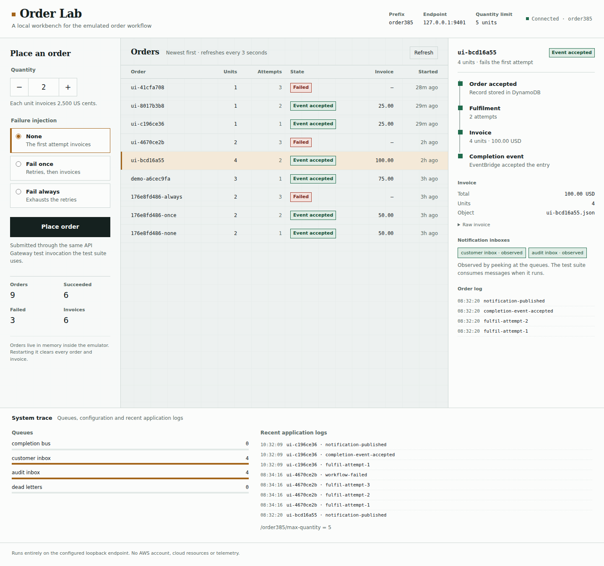

# AWS Emulator Order Lab

A local integration-testing example targeting API Gateway, Lambda, Step Functions, DynamoDB,
S3, EventBridge, SQS, SNS, CloudWatch Logs and SSM Parameter Store through AWS Emulator. It
includes a self-contained dashboard for placing orders and watching the workflow, plus a strict
integration suite and a CLI.

**Validated on AWS Emulator 1.0.385 on 2026-11-15.** All 12 integration checks passed,
including a second run after restarting the emulator and provisioning fresh state. Eighteen
offline tests and checks for 40 explicit SDK operations also passed. The dashboard was exercised
in a browser for successful, retried and failed orders at desktop and mobile widths. Captured
results are in `evidence/integration-fresh.json`, `evidence/offline-tests.txt`, `evidence/ui-desktop.png`,
`evidence/ui-mobile.png` and `evidence/ui-check.json`.

Source: [mtwn105/aws-emulator-order-lab](https://github.com/mtwn105/aws-emulator-order-lab).
Built by [Amit Wani (@mtwn105)](https://github.com/mtwn105). Companion article prepared for
[Medium](https://medium.com/@mtwn105); the article URL will be added after publication.



[View all app and StackPort screenshots](docs/screenshots/README.md).

## Architecture

```text
API Gateway TestInvokeMethod → Lambda submit → DynamoDB order
                                    ↓
                              Step Functions
                          fulfil → publish completion
                            ↓            ↓
                       S3 invoice    EventBridge rule
                                         ↓
                                        SQS
                                         ↓ automatic event source mapping
                                   Lambda notify
                                         ↓
                                        SNS
                                     ↙       ↘
                              customer SQS  audit SQS

Parameter Store → validation limit; CloudWatch Logs ← explicit application logs
```

IAM supplies execution roles and STS checks the account; neither counts as an app feature.
No payment provider, email or shipping system is contacted. Inventory reservation is outside
this minimal example. Invoices use synthetic quantities at 2,500 US cents per unit.

## Prerequisites

Native Linux, the current AWS Emulator release, and [uv](https://docs.astral.sh/uv/) (or
Python 3.12–3.14 with venv and pip). `pyproject.toml` and `uv.lock` pin the complete dependency
set; `requirements.lock` remains a pip fallback with the same versions. The configured
`python3.12` function uses the emulator’s embedded interpreter and supplied SDK adapter. Follow
the official [Linux setup](https://docs.aws.amazon.com/emulator/latest/userguide/getting-started-linux.html).

The successful full run used CPython 3.12.14 and boto3/botocore 1.43.124 for the client tools,
and emulator 1.0.385 (commit 813af480bf7f16d5418b64e4f5644a74a7da11c5). Refresh the current
release before running; this is a recorded test version, not an emulator pin. AWS CLI is optional.

The [Docker setup](https://docs.aws.amazon.com/emulator/latest/userguide/getting-started-docker.html)
is an option for other hosts. Host clients need access to the emulator-issued credentials
and CA; the function uses the emulator-provided SDK and does not read host credential files.
The complete Docker adaptation is not validated here.

## Quick start

```bash
git clone https://github.com/mtwn105/aws-emulator-order-lab.git
cd aws-emulator-order-lab
```

From the cloned repository directory, start a dedicated emulator on a host that permits loopback networking:

```bash
mkdir -p .local
nohup aws-emulator -p 9297 -t off --idle-timeout 900 > .local/emulator.log 2>&1 &
printf '%s\n' "$!" > .local/emulator.pid
```

Telemetry is enabled by default; `-t off` disables it. Authentication stays enabled. Keep the
loopback bind. Poll readiness for up to 30 seconds with this run's CA:

```bash
for attempt in $(seq 1 30); do
  if curl -fsS --cacert "$HOME/.aws/emulator/9297/ca.pem" \
    https://127.0.0.1:9297/__admin/health; then
    break
  fi
  sleep 1
done
curl -fsS --cacert "$HOME/.aws/emulator/9297/ca.pem" \
  https://127.0.0.1:9297/__admin/health
```

Readiness should return `ok`; this is expected output, not a captured successful run.

```bash
uv sync
uv run python -m unittest discover -s tests -v
uv run python check_contracts.py
uv run python bootstrap.py
uv run python integration.py
uv run python app.py
```

`uv sync` creates `.venv` from `uv.lock`. The dashboard then serves
<http://127.0.0.1:9410>. Without uv, create a venv and install `requirements.lock` with pip; the
dependency versions are identical. The emulator should use the current release.

Optional configuration (keep the same values for bootstrap, testing and the dashboard):

```bash
export LAB_ENDPOINT=https://127.0.0.1:9297
export LAB_EMULATOR_DIR="$HOME/.aws/emulator/9297"
export LAB_PREFIX=orderlab
```

No real keys belong in these settings. SDK clients explicitly use the loopback endpoint,
emulator-issued credentials and generated CA, bypass HTTP proxies, and verify account
`000000000000` before provisioning or testing. Inside the emulator’s embedded Python runtime,
a guarded branch uses the supplied SDK adapter. The Lambda ZIP contains only application code.
Do not vendor CPython boto3 into it: that failed on this release with an import error.
The host clients still use the fully pinned boto3 dependencies.

## Dashboard

`app.py` serves a local workbench and a small JSON API from the Python standard library. It reads
the same `.local/resources.json`, emulator credentials and `LAB_*` settings as the other tools,
and binds to `127.0.0.1` only.

```bash
uv run python app.py            # http://127.0.0.1:9410
uv run python app.py --port 9411
```

The page has three parts:

- **Place an order** submits through API Gateway `TestInvokeMethod` with a quantity and an
  optional injected failure, then watches the workflow.
- **Orders** lists the state machine's executions newest first with stored state, attempt count
  and invoice total. It refreshes every three seconds.
- **Detail** shows a workflow spine (accepted → fulfilment → invoice → completion event), the
  invoice and its JSON, inbox observations, and log lines for that order. The **System trace**
  footer shows queue depths, the validation limit and recent application logs.

`evidence/ui-desktop.png` and `evidence/ui-mobile.png` are real captures of this page against
1.0.385; `evidence/ui-check.json` records what was exercised.

The JSON API is deliberately small: `GET /api/lab`, `GET /api/orders`,
`GET /api/orders/{id}`, `GET /api/system`, and `POST /api/orders`. Inbox observations use
`ReceiveMessage` with `VisibilityTimeout=0`, so they peek without consuming messages. The
dashboard adds no AWS features to the workflow; it is a local inspection surface for the same
lab. It has no authentication and must stay on loopback.

## Browse the resources with StackPort

The app dashboard at port 9410 presents the order workflow. StackPort is an optional, separate
resource console at port 8080. AWS Emulator itself serves APIs and has no built-in graphical UI.
See the [StackPort AWS Emulator guide](https://stackport.cloud/docs/guides/aws-emulator/).

Keep the same emulator running and open another terminal. From the project directory:

```bash
AWS_ENDPOINT_URL="${LAB_ENDPOINT:-https://127.0.0.1:9297}" \
AWS_REGION=us-east-1 STACKPORT_HOST=127.0.0.1 \
uvx --python 3.12 --with boto3==1.43.124 --with botocore==1.43.124 \
  --from stackport==0.4.11 stackport
```

Open <http://127.0.0.1:8080>. StackPort discovers the emulator's keys and CA under
`~/.aws/emulator/<port>/`; set the endpoint explicitly. It runs outside this project's uv.lock.
The recorded screenshots used port 9401 and prefix `order385`; the defaults above use 9297 and
`orderlab`. Match the settings used by bootstrap.

- **dynamodb** → `<prefix>-orders`: open the item browser and compare quantity, status and
  attempts for an order ID from the app. The approximate table count may lag the actual rows.
- **sqs** → `<prefix>-customer` or `<prefix>-audit` → **Poll for messages**: inspect matching
  orderId payloads. This version peeks with visibility timeout zero. Avoid delete/purge while
  inspecting; the integration suite consumes messages independently.
- **s3** → `<prefix>-invoices` → `<orderId>.json`: inspect metadata or download the invoice.
  The object's Raw tab displays metadata, not its body.
- **stepfunctions** → `<prefix>`: compare SUCCEEDED and FAILED executions.
- **logs** → `/<prefix>/orders` → `orders`: expand Filters and apply a quoted order ID.

StackPort 0.4.11 was run against the existing native lab. The normal registry download initially
stalled; the successful run used a resumed local wheel with the same SDK versions as the lab.
If downloads are slow, `UV_HTTP_TIMEOUT=180` increases uv's timeout. A dependency-download failure
occurs before UI startup and does not diagnose the emulator connection.

## Verification

`integration.py` calls the configured API Gateway method through **TestInvokeMethod**. It
asserts invalid-input rejection, normal invoice creation, retry-once, permanent failure with
no invoice, delivery into both notification inboxes, sequential repeated submission,
conflicting input, changed configuration and correlated logs. It does not bypass a broken
trigger with a direct function call.

A passing run prints PASS per assertion and writes `.local/integration-results.json` with
`status: PASSED`. Captured full-run evidence is in `evidence/integration-fresh.json`.
Failures exit unsuccessfully and write `status: FAILED`. Run one suite at a
time: it consumes notification messages and temporarily changes a shared parameter.

Eighteen offline tests cover handler validation, retries, failed event entries, partial-batch
responses, the local-only client boundary and the dashboard's pure helpers. They are recorded
in `evidence/offline-tests.txt` and run without an emulator.

After a run, use an order ID formed from `runId` in the results plus `-none`, `-once` or `-always`:

```bash
python inspect_order.py YOUR_ORDER_ID
```

## Submit your own order

`submit_order.py` posts one order through the same API Gateway test invocation the suite uses,
waits for the workflow, and prints the ID to inspect:

```bash
python submit_order.py                       # quantity 2, no injected failure
python submit_order.py --quantity 4          # invoice: 4 × 2500 = 10000 cents
python submit_order.py --failure once        # first fulfilment attempt fails, retry succeeds
python submit_order.py --failure always      # exhausts three attempts, no invoice
```

The command exits 0 after any completed workflow; `FAILED` is a valid outcome for the injected
failure. A non-202 response means validation rejected the order. Messages delivered to the
subscriber queues remain available for a later `ReceiveMessage` call.

## Limits and tradeoffs

- TestInvokeMethod is not a deployed HTTP endpoint. Stages, CORS and authorization enforcement
  are not tested; the dashboard is a local tool, not a deployed frontend. It has no user
  accounts and should only listen on loopback.
- Repeated submission uses the same Standard execution name and input. It can repair the
  record-created/execution-not-started gap; it cannot restart a finished failed execution.
- The invoice key is deterministic and a sequential repeat skips completed fulfilment. The
  example does not guarantee concurrent duplicate prevention or exactly-once processing.
- Event publication and state updates are separate writes. Retries can duplicate notifications;
  consumers must tolerate duplicates. Notification deduplication is not implemented.
- SQS has a DLQ and the handler returns partial-batch failures. DLQ redrive timing is configured
  but not exercised by the suite. Step Functions task retries are a separate mechanism.
- Logs are written explicitly; automatic runtime logging and metrics are not asserted.
- Classic EventBridge `events` APIs are an explicit compatibility target, not a production
  recommendation about which EventBridge offering to choose.
- The Lambda role includes a resource-scoped runtime policy derived from IAM Policy Autopilot
  (`runtime-policy.json`) plus queue-polling permissions. Step Functions has a separate role
  with permission to invoke the handler. The generated baseline includes optional actions;
  review and refine it separately for any cloud deployment. These local checks do not prove
  IAM/KMS enforcement or production security. This is not a cloud deployment template.
- Use synthetic data. No performance, load-testing or production-readiness claims are made.

## Troubleshooting and cleanup

HTTP 501 / NotImplemented is a coverage gap. A created rule with no delivered message also
fails the integration test. Inspect `.local/emulator.log` and check exact operations and
behavior using [AWS's compatibility procedure](https://docs.aws.amazon.com/emulator/latest/userguide/check-project.html).
Do not disable TLS verification to bypass a certificate error.

Bootstrap expects a fresh prefix and does not resume partial provisioning. Restart the dedicated
emulator or choose another `LAB_PREFIX` (3–20 lowercase ASCII letters/digits, starting with a
letter). Restarting deletes all emulated resources. Confirm the recorded PID still belongs to
your emulator before sending SIGTERM; the idle timeout also stops it. `.local/` and `.venv/`
are disposable. Never commit per-run credentials, config or CA files.

No cloud resources or CI pipeline are required. The source is a standalone local lab. The
companion article remains unpublished; its final Medium URL will be added when available.

## Changes established by the live run

The initial 16.7 MB SDK-vendored ZIP was rejected with HTTP 413. A smaller vendored package
uploaded, but failed importing `http.client.IncompleteRead`. Using the emulator-supplied SDK
fixed invocation. SQS mapping creation then required polling permissions, and Lambda calls
required the runtime policy. The final suite passed through the configured services without
substituting direct handler calls for triggers. Diagnostic direct invocations were used only
to identify errors during development.

The complete generated IAM baseline is retained as `evidence/iam-autopilot-baseline.json`.
`runtime-policy.json` retains the relevant service statements; bootstrap scopes resources to
the local lab and adds the implicit queue-polling/workflow-invocation permissions separately.
KMS and S3 Object Lambda alternatives were omitted because this lab does not use those paths.
