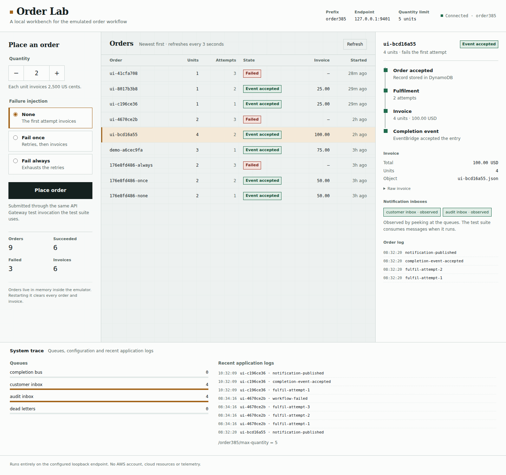
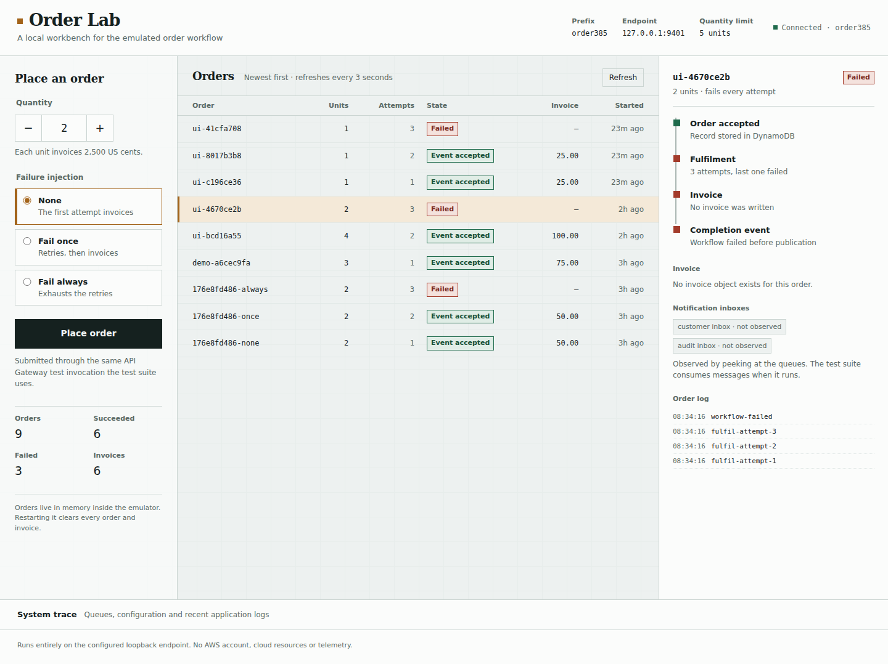
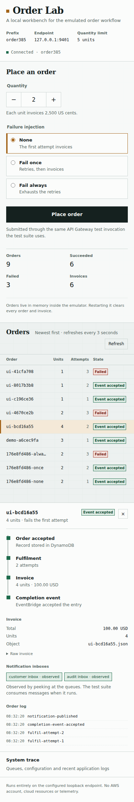
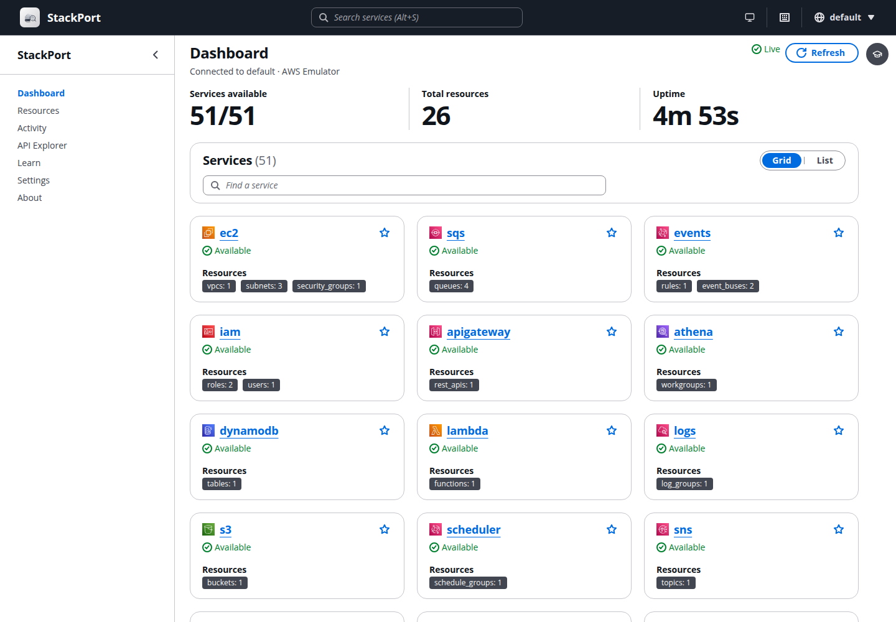
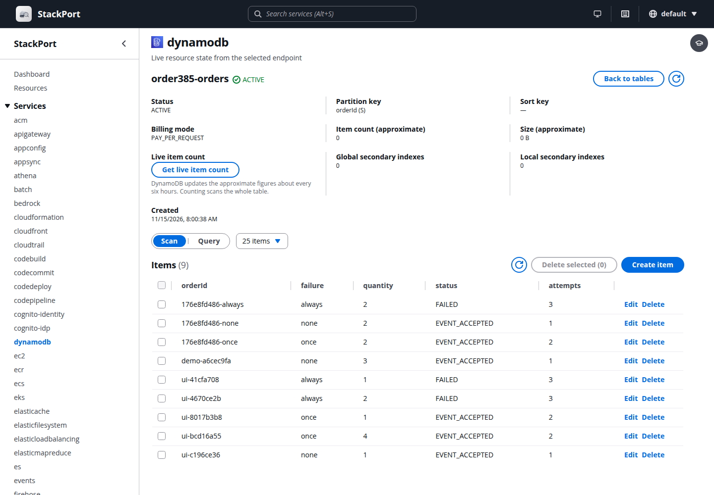
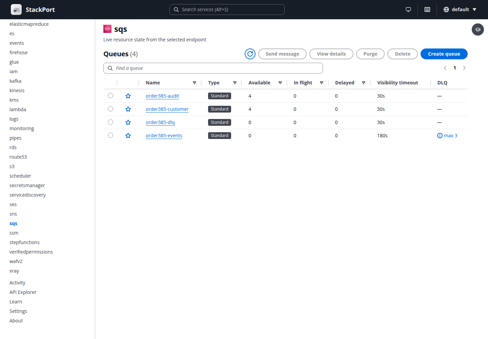
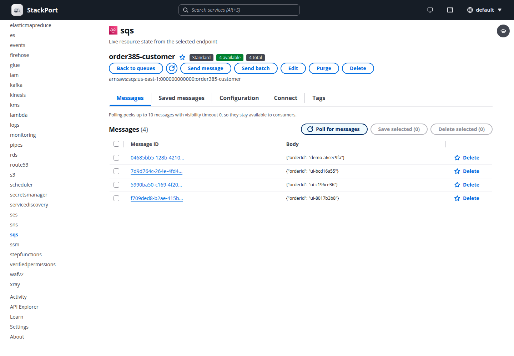
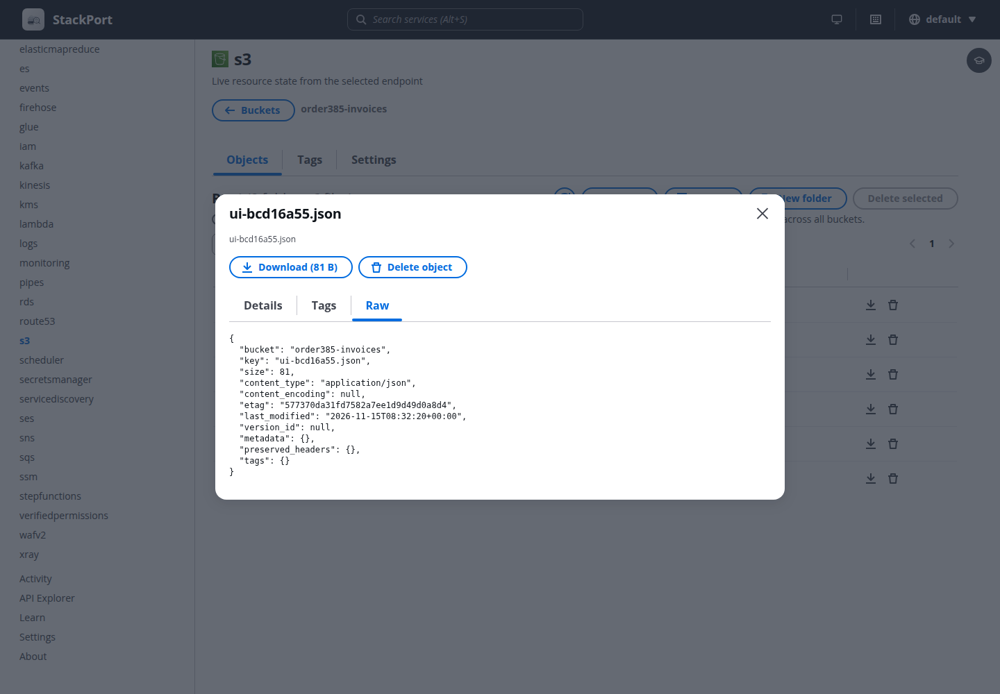
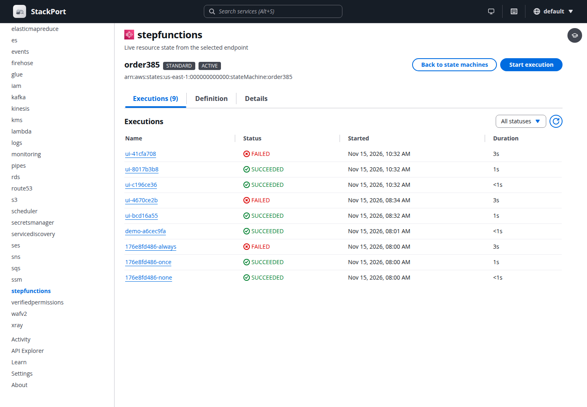
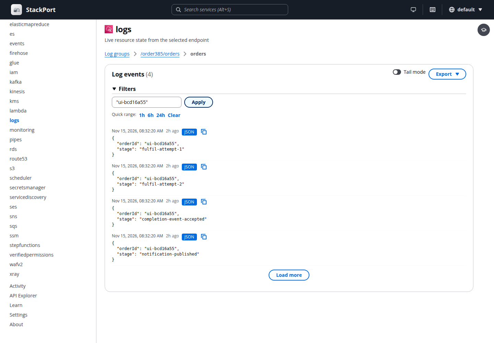

# Screenshots

Actual, unedited captures of the running local order lab and StackPort on 2026-11-15 UTC.

App: port 9410. StackPort 0.4.11: port 8080. Both inspected the existing emulator at https://127.0.0.1:9401 with prefix order385. The README quick start uses default port 9297 and prefix orderlab.

Capture timestamps, dimensions, hashes and limitations are in [manifest.json](manifest.json). StackPort is an independent project; see its [AWS Emulator guide](https://stackport.cloud/docs/guides/aws-emulator/).

## Retry-once order ui-bcd16a55; system trace expanded

## Permanent-failure order ui-4670ce2b

## 390-pixel viewport; ui-bcd16a55 selected

## Service dashboard

## Order item browser

## Four lab queues

## order385-customer selected; Poll for messages

## order385-invoices/ui-bcd16a55.json metadata; Raw tab

## State machine order385 selected; execution list

## Filter pattern "ui-bcd16a55"; four matching entries

